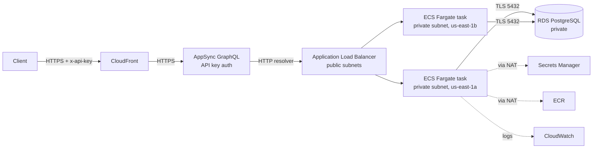

# Secure Employee Management API

AWS DevOps practical assessment: an Employee Management REST API deployed on AWS behind the required request flow:

**Internet → CloudFront → AWS AppSync → Application Load Balancer → ECS Fargate → RDS PostgreSQL**

| | |
|---|---|
| Application | Node.js 22, Express 5, PostgreSQL (`pg`) |
| Region | `us-east-1` |
| Infrastructure | Built via AWS Console and CLI (manual configuration was permitted by the assessment brief) |
| CI/CD | GitHub Actions with GitHub OIDC → AWS IAM role (no stored AWS keys) |
| Full documentation | [docs/Employee-API-AWS-DevOps-Assessment.pdf](docs/Employee-API-AWS-DevOps-Assessment.pdf) |

---

## Architecture



### Network

```
VPC employee-vpc 10.0.0.0/16
├── Public subnets  10.0.0.0/20 (1a), 10.0.16.0/20 (1b)   → route 0.0.0.0/0 → Internet Gateway
│     ALB (emp-alb), NAT Gateway
└── Private subnets 10.0.128.0/20 (1a), 10.0.144.0/20 (1b) → route 0.0.0.0/0 → NAT Gateway
      ECS Fargate tasks (no public IP), RDS PostgreSQL (not publicly accessible)
```

### Security group chain (least privilege)

| Security group | Inbound | Source |
|---|---|---|
| `emp-alb-sg` | TCP 80 | 0.0.0.0/0 |
| `emp-ecs-sg` | TCP 8080 | `emp-alb-sg` only |
| `emp-rds-sg` | TCP 5432 | `emp-ecs-sg` only |

### AWS resources

| Component | Name | Key settings |
|---|---|---|
| CloudFront | `d1a7kv1va3r66w.cloudfront.net` | Origin = AppSync (HTTPS only), CachingDisabled, AllViewerExceptHostHeader, HTTP→HTTPS redirect |
| AppSync | `employee-api-graphql` | Public, API key auth, HTTP data source → ALB, JavaScript resolvers |
| ALB | `emp-alb` | Internet-facing, listener HTTP:80 → target group `emp-tg` |
| Target group | `emp-tg` | IP targets, HTTP 8080, health check `/health` (2/2 thresholds, 15 s interval), deregistration delay 30 s |
| ECS | `employee-cluster` / `employee-api-service` | Fargate, 2 tasks, rolling 100%/200%, circuit breaker with rollback, private subnets |
| Task definition | `employee-task` | 0.25 vCPU / 512 MB, container `employee-api:8080`, health check, awslogs |
| ECR | `employee-api` | Tagged with git commit SHA, scan on push |
| RDS | `employee-db` | PostgreSQL, db.t4g.micro, encrypted, private, password managed by Secrets Manager |
| Monitoring | Dashboard `employee-api`, SNS `employee-alerts` | Alarms: ECS CPU > 80%, unhealthy targets, 5xx errors |

---

## API documentation

Base URL (behind the ALB): `http://<alb-dns-name>`; port `8080` inside the container.

| Method | Path | Description | Responses |
|---|---|---|---|
| GET | `/health` | Liveness check | `200 {"status":"UP"}` |
| GET | `/employees` | List employees | `200` array |
| GET | `/employees/{id}` | Get one employee | `200`, `404` |
| POST | `/employees` | Create employee | `201`, `400` (missing/empty fields) |
| PUT | `/employees/{id}` | Update employee | `200`, `400`, `404` |
| DELETE | `/employees/{id}` | Delete employee | `204`, `404` |

Employee object:

```json
{ "id": 1, "name": "Akash", "department": "QA", "email": "akash@example.com" }
```

`name`, `department` and `email` are required non-empty strings for POST and PUT.

### GraphQL (through CloudFront)

```
POST https://d1a7kv1va3r66w.cloudfront.net/graphql
Content-Type: application/json
x-api-key: <AppSync API key>
```

```graphql
query GetEmployees {
  employees { id name department email }
}

query GetEmployee($id: ID!) {
  employee(id: $id) { id name department email }
}
```

Without a valid API key the API returns `401 UnauthorizedException`. The API key is intentionally not published in this repository.

---

## Run locally with Docker

```bash
docker build -t employee-api .
docker run -p 8080:8080 employee-api
curl http://localhost:8080/health        # {"status":"UP"}
curl http://localhost:8080/employees
```

Without `DB_HOST` the app uses an in-memory store, so it runs without a database. With PostgreSQL:

```bash
docker run -p 8080:8080 \
  -e DB_HOST=<host> -e DB_PORT=5432 -e DB_NAME=employees \
  -e DB_USER=<user> -e DB_PASSWORD=<password> \
  employee-api
```

`DB_SSL=false` disables TLS (local PostgreSQL only). In AWS, TLS is verified with the RDS CA bundle baked into the image.

Unit tests (no database needed):

```bash
npm ci
npm test
```

### Docker image hardening

- `node:22-alpine` base, `apk upgrade` for OS security patches
- Production dependencies only; npm and corepack removed from the runtime image
- Runs as the non-root `node` user
- `HEALTHCHECK` on `/health`
- Exec-form `CMD`, so Node receives `SIGTERM` and shuts down gracefully during deployments

---

## Deployment

### Image versioning

- CI tags every image with the **git commit SHA** (for example `employee-api:e207ac649744...`), so each running task can be traced to its exact commit.
- `latest` is not used for deployments.
- Rollback: point the ECS service at the previous task definition revision.

### Manual push to ECR

```bash
aws ecr get-login-password --region us-east-1 | docker login --username AWS --password-stdin <account>.dkr.ecr.us-east-1.amazonaws.com
docker tag employee-api:<version> <account>.dkr.ecr.us-east-1.amazonaws.com/employee-api:<version>
docker push <account>.dkr.ecr.us-east-1.amazonaws.com/employee-api:<version>
```

### Infrastructure setup order

1. VPC with 2 public and 2 private subnets across 2 AZs, Internet Gateway, NAT Gateway, route tables
2. Security groups `emp-alb-sg` → `emp-ecs-sg` → `emp-rds-sg`
3. RDS PostgreSQL in private subnets, credentials managed in Secrets Manager
4. Inline policy on `ecsTaskExecutionRole`: `secretsmanager:GetSecretValue` on the DB secret only
5. ECR repository and image
6. Target group `emp-tg` (IP, `/health`) and ALB `emp-alb` (public subnets)
7. Task definition with `DB_HOST`, `DB_PORT`, `DB_NAME` (values) and `DB_USER`, `DB_PASSWORD` (from Secrets Manager)
8. ECS service: 2 tasks, private subnets, `emp-ecs-sg`, no public IP, behind `emp-tg`
9. AppSync API, HTTP data source pointing at the ALB, resolvers
10. CloudFront distribution with AppSync as origin
11. CloudWatch dashboard, alarms and SNS topic
12. GitHub OIDC identity provider and IAM role for CI/CD

Each step, with console settings, is described in the [full documentation](docs/Employee-API-AWS-DevOps-Assessment.pdf).

---

## CI/CD workflow

[.github/workflows/deploy.yml](.github/workflows/deploy.yml) runs on every push to `main`:

```
Git push
  └─ Job 1: Build & Unit Test
       ├─ Build (npm ci)
       └─ Unit test (npm test)
  └─ Job 2: Docker Build, Scan, Push & Deploy   (only if job 1 passes)
       ├─ Docker build (tag = commit SHA)
       ├─ Trivy security scan (fails on fixable HIGH/CRITICAL)
       ├─ Configure AWS credentials via OIDC
       ├─ Push to ECR
       ├─ Deploy to ECS (new task definition revision, rolling update, wait for stability)
       └─ Verify deployment (new revision running, /health UP, GraphQL query via CloudFront)
```

- **No AWS credentials are stored in GitHub.** The job requests a GitHub OIDC token and assumes the IAM role `github-actions-employee-api`, whose trust policy only allows this repository's `main` branch.
- The role can only push to the `employee-api` ECR repository, register task definitions, update the ECS service, and pass `ecsTaskExecutionRole` to ECS.
- Repository settings: variable `AWS_ROLE_ARN`; secret `APPSYNC_API_KEY` (used by the verify step).
- Changes that only touch `docs/` or Markdown files do not trigger a deployment.

---

## Security approach

| Area | Control |
|---|---|
| Edge | HTTPS through CloudFront, HTTP redirected; AppSync API key required |
| Network | ECS and RDS in private subnets, no public IPs; NAT for outbound only |
| Security groups | ALB → ECS → RDS chain using security group references; no `0.0.0.0/0` on 8080 or 5432 |
| Secrets | DB password managed by Secrets Manager and injected by ECS at task start; nothing in code, Dockerfile, image or GitHub |
| Data | RDS encrypted at rest; TLS in transit with certificate verification |
| IAM | Least privilege: execution role reads one secret; no task role; CI role scoped to one repo and the deploy actions |
| CI/CD | OIDC instead of access keys; Trivy gate; ECR scan on push |
| Container | Non-root user, patched base image, npm removed from runtime |
| Source control | `.gitignore` excludes `.env`, `node_modules`, Terraform state and tfvars |

---

## Monitoring

- **Logs:** CloudWatch Logs group `/ecs/employee-task` (7-day retention)
- **Dashboard `employee-api`:** ECS CPU and memory, ALB requests and 5xx errors, response time p50/p95/p99, healthy/unhealthy targets, alarm status, recent logs
- **Alarms** (notify SNS topic `employee-alerts`):
  - `employee-ecs-cpu-high`: ECS service average CPU > 80% for 3 consecutive minutes
  - `employee-unhealthy-targets`: at least one unhealthy target for 2 minutes
  - `employee-5xx-errors`: more than 5 application 5xx responses per minute for 2 minutes

---

## Troubleshooting

### Tracing a 5xx through CloudFront → AppSync → ALB → ECS

Test each hop separately, from the outside in. The first hop that fails is where the problem is.

1. **CloudFront:** check the error page and `x-cache` header. Call the AppSync endpoint directly with the same request; if that works, the problem is CloudFront configuration (methods, origin path, header forwarding).
2. **AppSync:** enable logging (field resolver level ALL) and check `/aws/appsync/apis/<api-id>` for the request sent to the ALB and the response received.
3. **ALB:** `curl http://<alb>/health`. `503` = no healthy targets, `502` = bad response from the app, `504` = timeout. Compare `HTTPCode_ELB_5XX_Count` with `HTTPCode_Target_5XX_Count`.
4. **ECS:** service Events tab, stopped tasks' stopped reason, and logs in `/ecs/employee-task`.
5. **Database:** application logs for connection timeouts or authentication errors.

### Common issues

| Issue | Cause | Solution |
|---|---|---|
| ALB returns `503` | No healthy targets | Check `emp-tg` targets; `emp-ecs-sg` must allow 8080 from `emp-alb-sg`; health path must be `/health` |
| CloudFront returns `403` "request could not be satisfied" | Viewer `Host` header forwarded to AppSync | Use origin request policy **AllViewerExceptHostHeader**; leave origin path empty |
| Tasks stop with `ResourceInitializationError: unable to pull secrets` | Execution role cannot read the secret, or no route to Secrets Manager | Check the `secretsmanager:GetSecretValue` policy and ARN; private route table needs `0.0.0.0/0 → NAT` |
| App logs `connect ETIMEDOUT` to the database | RDS security group blocks the tasks | `emp-rds-sg` must allow 5432 from `emp-ecs-sg` |
| GraphQL returns `401 Unauthorized` | Missing or wrong API key | Send `x-api-key`; rotate in AppSync → Settings → API keys |
| Pipeline: `Not authorized to perform sts:AssumeRoleWithWebIdentity` | Trust policy subject does not match the OIDC token | Find the failed call in CloudTrail and match the trust policy `sub` to the subject GitHub sent (this repo uses GitHub's immutable subject format) |
| Pipeline fails at Trivy | A fixable HIGH/CRITICAL vulnerability | Read the Trivy table and upgrade the package or base image |

---

## Repository layout

```
.
├── .github/workflows/deploy.yml   CI/CD pipeline
├── src/
│   ├── app.js                     Routes, validation, error handling
│   ├── server.js                  Store selection, startup, graceful shutdown
│   └── store/
│       ├── memory.js              In-memory store (local runs, tests)
│       └── postgres.js            PostgreSQL store (AWS)
├── test/employees.test.js         Unit tests (node --test)
├── docs/                          Full documentation (PDF)
├── Dockerfile
├── .dockerignore
└── .gitignore
```
